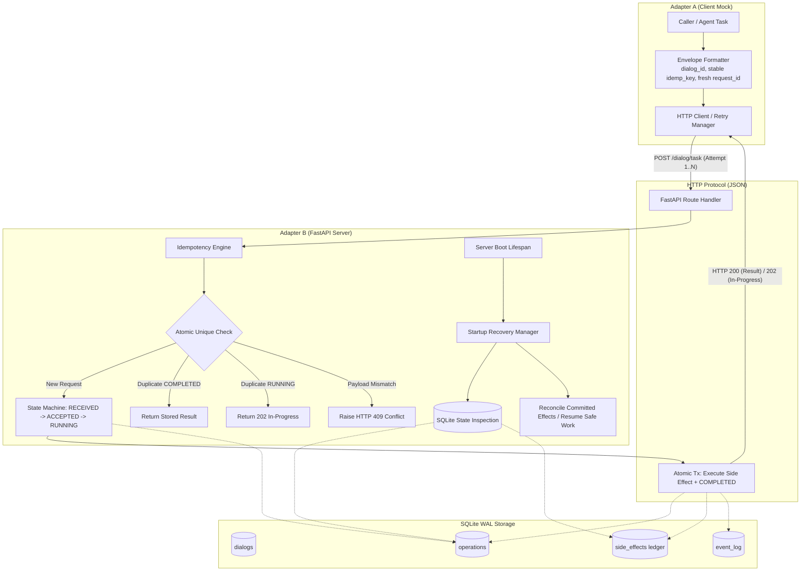

# PS-021: Architecture & System Design

> **Notice:** This document details an **experimental prototype** for dialog correlation and recovery across agent adapters. It does not claim official IETF standard compliance or complete MCP/A2A interoperability. It does not claim universal exactly-once delivery across uncoordinated network boundaries.

---

## 1. System Overview

PS-021 demonstrates reliable dialog correlation, durable state persistence, request deduplication, and crash recovery between two mock agent adapters:

- **Adapter A (Client-side Mock Adapter):** Initiates task requests, manages attempt numbering, stable dialog and idempotency identifiers, and executes automated retry policies upon network or server failures.
- **Adapter B (Server-side Mock Adapter / FastAPI):** Receives dialog requests, atomically registers them within a durable SQLite database, enforces lifecycle transitions, executes business logic side effects within the same SQLite transaction, suppresses duplicates, and runs a crash recovery protocol during startup.

---

## 2. Core Architectural Principles

### 2.1 Separation of Identifiers
- `dialog_id`: Stable throughout the lifetime of the logical conversation or cross-agent workflow.
- `idempotency_key`: Stable identifier representing a single intended business side effect across multiple retry attempts.
- `request_id`: Fresh, unique identifier generated per transmission attempt (e.g., `req_abc123` on attempt 1, `req_def456` on attempt 2).
- `attempt`: Monotonically increasing sequence integer (1, 2, ...).

### 2.2 Atomic Registration via Uniqueness Constraints
Registration of incoming requests never uses a non-transactional check-then-insert pattern. Instead, `idempotency_key` is backed by a primary key uniqueness constraint in SQLite. Concurrency is serialized using SQLite `BEGIN IMMEDIATE` transactions, eliminating duplicate creation races.

### 2.3 Single-Transaction Atomicity for Local Side Effects
For side effects internal to the SQLite database (e.g., account balance changes, reservation bookings, ledger entries), both the business mutation in `side_effects` and the state transition to `COMPLETED` occur in the **exact same SQLite transaction**.
- If a crash occurs before commit: both the side effect and the completion status roll back entirely.
- If a crash occurs after commit: both the side effect and the `COMPLETED` status persist durably on disk.

### 2.4 External Side Effects Disclaimer
In distributed architectures where an external service (e.g., Stripe, third-party LLM, external API) is invoked, atomic transactions across heterogeneous systems are impossible without two-phase commit (2PC) or compensating workflows. For such systems, the adapter pattern relies on external idempotency keys, outbox tables, and explicit reconciliation queries.

### 2.5 Startup Recovery Protocol
Upon process reboot, Adapter B executes `StartupRecoveryManager` during its FastAPI lifespan before accepting inbound traffic:
1. Queries all non-terminal operations (`RECEIVED`, `ACCEPTED`, `RUNNING`, `RECOVERING`).
2. Checks the durable `side_effects` ledger for each operation.
3. If the side effect was committed: reconciles the operation directly to `COMPLETED` using stored details without duplicate execution.
4. If the side effect was not committed: safely advances through `RECOVERING -> RUNNING`, executes the deterministic side effect, and transitions to `COMPLETED`.
5. Preserves all original `dialog_id` and `idempotency_key` bindings.
