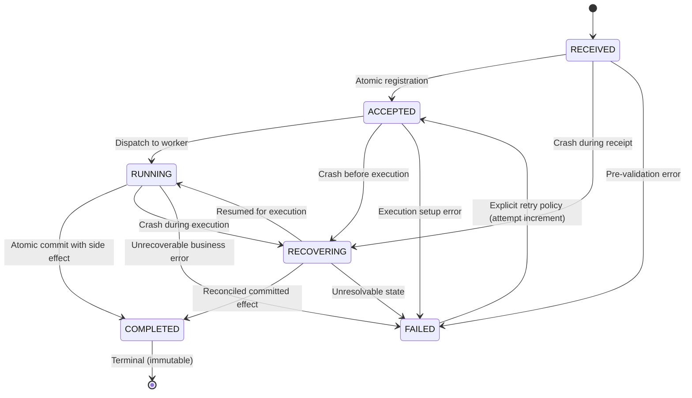

# PS-021: Experimental Dialog Correlation Schema & Lifecycle

> **Notice:** This schema is labeled **experimental (`1.0.0-exp`)**. It is designed for verifiable local dialog correlation and recovery across agent adapters, not as a standardized RFC or full MCP/A2A implementation.

---

## 1. Message Envelope Schema

All interactions between Adapter A and Adapter B utilize the unified Pydantic envelope `DialogMessage`.

```python
class DialogMessage(BaseModel):
    schema_version: str = "1.0.0-exp"
    dialog_id: str
    request_id: str
    idempotency_key: str
    source_adapter: str
    target_adapter: str
    task_type: str
    payload: Dict[str, Any]
    status: DialogStatus = DialogStatus.RECEIVED
    attempt: int = 1
    result: Optional[Dict[str, Any]] = None
    error: Optional[str] = None
    created_at: str
    updated_at: str
    version: int = 1
```

### Field Definitions

| Field | Type | Description |
|---|---|---|
| `schema_version` | String | Fixed version identifier (`1.0.0-exp`). Enforced on ingress. |
| `dialog_id` | String | Stable UUID identifying the overarching multi-turn dialog or conversation. |
| `request_id` | String | Ephemeral identifier generated fresh for each HTTP transmission attempt. |
| `idempotency_key` | String | Stable key uniquely representing the desired side-effecting task across retries. |
| `source_adapter` | String | Originating agent adapter (e.g. `adapter_a`). |
| `target_adapter` | String | Receiving agent adapter (e.g. `adapter_b`). |
| `task_type` | String | Business discriminator (e.g. `payment_transfer`, `reservation`). |
| `payload` | Dict | Arbitrary JSON payload required for the task. |
| `status` | Enum | Current lifecycle status of the task. |
| `attempt` | Integer | 1-based attempt sequence number. Incremented on retry. |
| `result` | Dict (Opt) | Persisted execution result upon completion. |
| `error` | String (Opt)| Persisted error message if status is `FAILED`. |
| `created_at` | ISO-8601 | UTC timestamp of initial task registration. |
| `updated_at` | ISO-8601 | UTC timestamp of last status transition. |
| `version` | Integer | Monotonically increasing counter for optimistic concurrency control. |

---

## 2. Deterministic Canonical Payload Hashing

To prevent idempotency key reuse with mismatched payloads, Adapter B generates a canonical SHA-256 digest of `payload`:

```python
def compute_canonical_payload_hash(payload: Any) -> str:
    canonical_json = json.dumps(payload, sort_keys=True, separators=(",", ":"))
    return hashlib.sha256(canonical_json.encode("utf-8")).hexdigest()
```

- Keys are recursively sorted.
- Whitespace is stripped (`separators=(',', ':')`).
- If an incoming request presents an existing `idempotency_key` with a different payload hash, Adapter B immediately rejects the request with **HTTP 409 Conflict** and `IdempotencyConflictError`.

---

## 3. Explicit Lifecycle State Machine

The lifecycle consists of six discrete states:



### Valid Transition Matrix

| From Status | Allowed Target Statuses | Notes |
|---|---|---|
| `RECEIVED` | `ACCEPTED`, `RECOVERING`, `FAILED` | Initial entry state. |
| `ACCEPTED` | `RUNNING`, `RECOVERING`, `FAILED` | Validated and persisted. |
| `RUNNING` | `COMPLETED`, `RECOVERING`, `FAILED` | Execution active. |
| `RECOVERING` | `RUNNING`, `COMPLETED`, `FAILED` | Invoked during startup recovery. |
| `FAILED` | `ACCEPTED` | Permitted only when client sends an explicit retry with higher `attempt`. |
| `COMPLETED` | *(None)* | **Strictly terminal**. No transitions permitted. |

---

## 4. SQLite Schema Definitions

```sql
CREATE TABLE dialogs (
    dialog_id TEXT PRIMARY KEY,
    schema_version TEXT NOT NULL,
    current_status TEXT NOT NULL,
    created_at TEXT NOT NULL,
    updated_at TEXT NOT NULL
);

CREATE TABLE operations (
    idempotency_key TEXT PRIMARY KEY,
    dialog_id TEXT NOT NULL,
    request_id TEXT NOT NULL,
    source_adapter TEXT NOT NULL,
    target_adapter TEXT NOT NULL,
    task_type TEXT NOT NULL,
    payload_json TEXT NOT NULL,
    payload_hash TEXT NOT NULL,
    status TEXT NOT NULL,
    attempt INTEGER NOT NULL DEFAULT 1,
    result_json TEXT,
    error TEXT,
    version INTEGER NOT NULL DEFAULT 1,
    created_at TEXT NOT NULL,
    updated_at TEXT NOT NULL,
    FOREIGN KEY(dialog_id) REFERENCES dialogs(dialog_id)
);

CREATE TABLE side_effects (
    effect_id TEXT PRIMARY KEY,
    idempotency_key TEXT NOT NULL,
    dialog_id TEXT NOT NULL,
    task_type TEXT NOT NULL,
    action TEXT NOT NULL,
    details_json TEXT,
    created_at TEXT NOT NULL,
    FOREIGN KEY(idempotency_key) REFERENCES operations(idempotency_key)
);

CREATE TABLE event_log (
    id INTEGER PRIMARY KEY AUTOINCREMENT,
    dialog_id TEXT NOT NULL,
    idempotency_key TEXT NOT NULL,
    request_id TEXT NOT NULL,
    from_status TEXT,
    to_status TEXT NOT NULL,
    version INTEGER NOT NULL,
    timestamp TEXT NOT NULL,
    details TEXT
);
```
